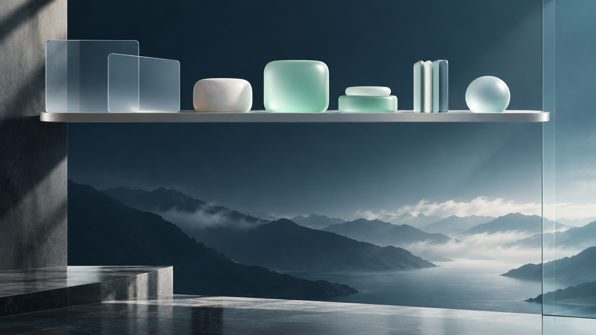

# Will Lee

**把想法，做成小产品。**

从一个具体的问题开始，做成可以使用的东西。

[个人站点 ↗](https://iamwilllee.github.io/iamwilllee/) · [GitHub](https://github.com/iamwilllee)

## 精选作品

<table>
<tr>
<td width="50%" valign="top">

<h3><a href="https://aster.iamwilllee.com/">Aster</a></h3>

Web 产品底座

Web · 开源底座 · Codex Skill
</td>
<td width="50%" valign="top">

<h3><a href="https://makenue.iamwilllee.com/">Makenue</a></h3>

开发者的店铺

Web · 创作者平台 · Agent 发布助手
</td>
</tr>
<tr>
<td width="50%" valign="top">

<h3><a href="https://perch.iamwilllee.com/">栖栏 · Perch</a></h3>

Mac 顶部图标栏

macOS 14+ · 原生菜单栏 · Apple Silicon
</td>
<td width="50%" valign="top">

<h3><a href="https://runo.iamwilllee.com/">Runo</a></h3>

本地项目启动器

macOS · 项目启动器 · Codex 项目台
</td>
</tr>
</table>

## 也在做这些

<b>研究与创作</b> 
<a href="https://cluefolio.iamwilllee.com/">Cluefolio · 迹册</a> · <a href="https://lefio.iamwilllee.com/">留页 · Lefio</a> · <a href="https://inspire.iamwilllee.com/">灵感图鉴</a> · <a href="https://realcut.iamwilllee.com/">RealCut</a>

<b>亲子与家庭</b> 
<a href="https://xiaohuayu.iamwilllee.com/">小画屿</a> · <a href="https://taleloop.iamwilllee.com/">跟读岛 TaleLoop</a> · <a href="https://xiaoshiye.iamwilllee.com/">小拾页</a>

<b>日常工具</b> 
<a href="https://sticker.iamwilllee.com/">切切贴</a>

[浏览完整作品集 →](https://iamwilllee.github.io/iamwilllee/)
