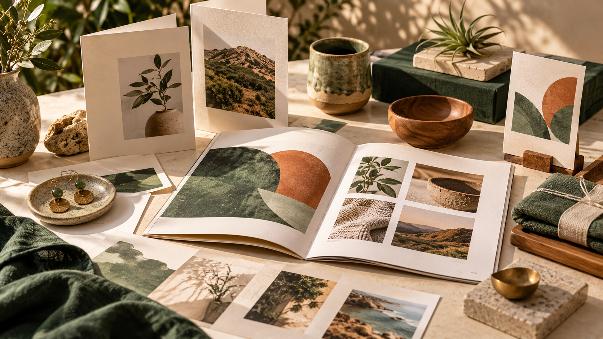
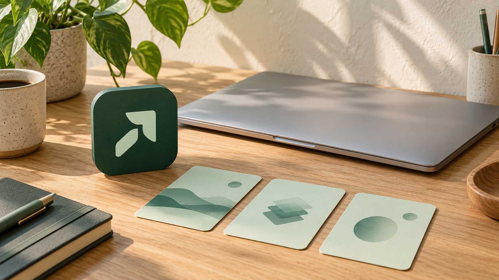
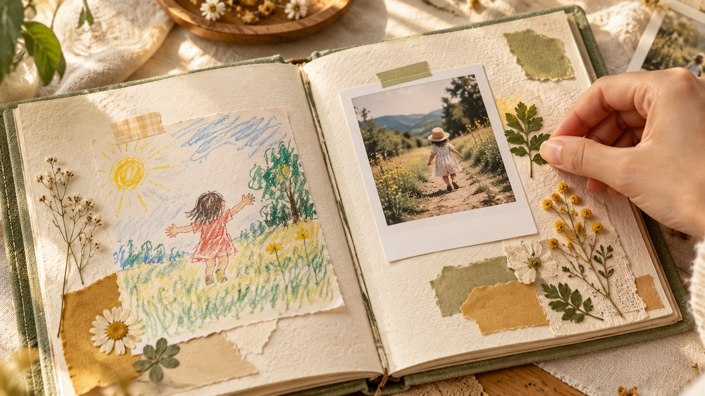
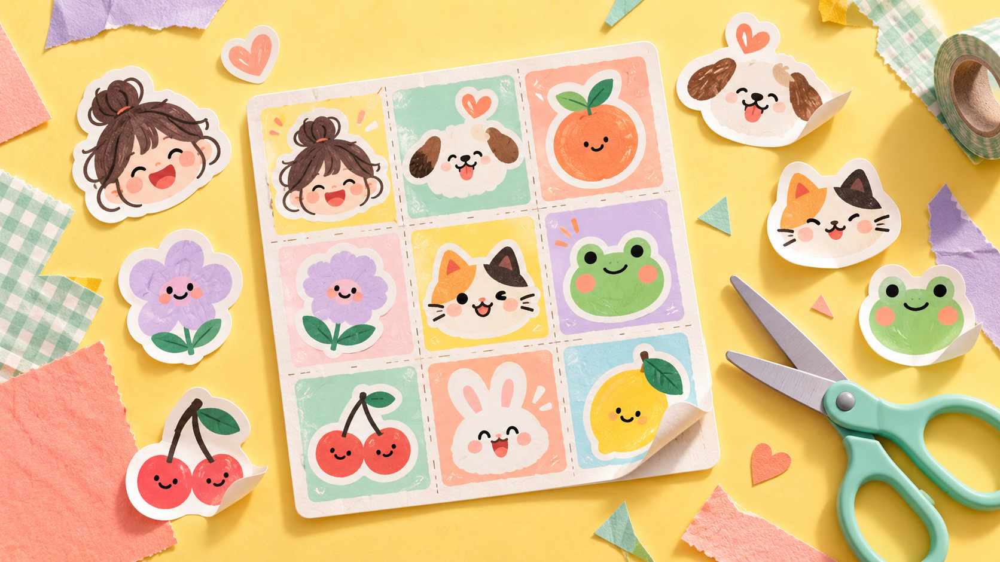

# Will Lee

**把想法，做成小产品。**

从一个具体的问题开始，做成可以使用的东西。

[GitHub](https://github.com/iamwilllee)

## 我的作品

<table>
<tr><td width="100%">

<b>Aster</b> · 面向 Agent 与独立开发者的开源 Web 产品底座，按需组合能力并增量开发。

Web · 开源底座 · Codex Skill

</td></tr>
<tr><td width="100%">

<b>Makenue</b> · 独立开发者的产品与服务店铺，支持发现作品、私有编辑及 Agent 预览确认。

Web · 创作者平台 · Agent 发布助手

</td></tr>
<tr><td width="100%">

<b>Runo</b> · 一个 macOS 菜单栏项目启动器，也是一块放在 Codex 里的项目台。把项目的启动配置、画面和日志放在一起，让你从一个想法，更快回到正在做的事。

macOS · 项目启动器 · Codex 项目台

</td></tr>
<tr><td width="100%">

<b>小画屿</b> · 2–5 岁儿童的互动故事绘本

微信小程序

</td></tr>
<tr><td width="100%">

<b>跟读岛 TaleLoop</b> · 看动画，听懂故事，开口说英语

Web

</td></tr>
<tr><td width="100%">

<b>小拾页</b> · 给一家人的私密成长纪念册

微信小程序

</td></tr>
<tr><td width="100%">

<b>灵感图鉴</b> · 发现 / 收藏 / 投稿 AI 图片 Prompt

WEB · 微信小程序 · Chrome 插件

</td></tr>
<tr><td width="100%">

<b>切切贴</b> · 一张大图秒变整套贴纸

WEB 静态站 · 本地运行

</td></tr>
</table>
