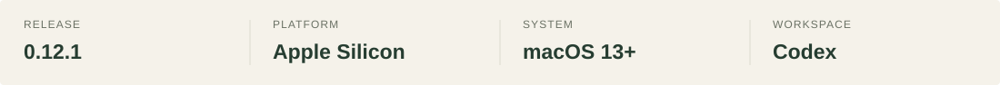
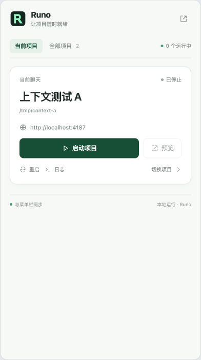
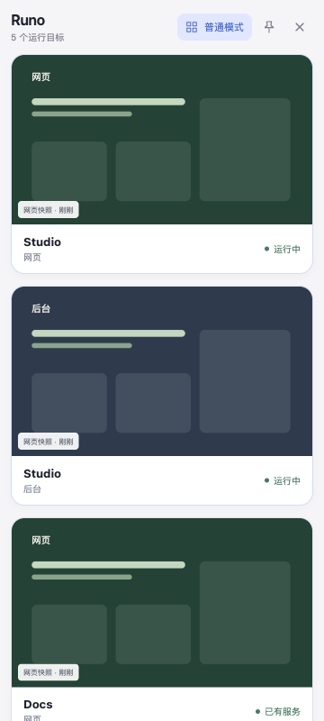
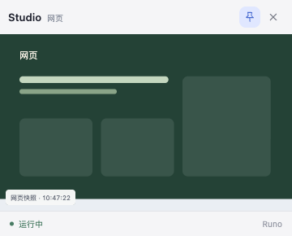

<p>
  
</p>

# Runo

**让本地项目，随时就绪。**

一个 macOS 菜单栏项目启动器，也是一块放在 Codex 里的项目台。把项目的启动配置、画面和日志放在一起，让你从一个想法，更快回到正在做的事。

<p>
  <a href="https://runo-4wk.pages.dev/">浏览官网 ↗</a> &nbsp; · &nbsp;
  <a href="https://github.com/iamwilllee/runo/releases/tag/v0.12.1">下载 0.12.1</a> &nbsp; · &nbsp;
  <a href="#三步回到你的项目">开始使用</a>
</p>

<p>
  
</p>

> 当前为测试版。仓库与安装包是私有的，下载需要访问权限；采用 ad hoc 签名，尚未完成 Developer ID 签名与 Apple 公证。

## 把项目，放在顺手的位置

<table>
  <tr>
    <td width="40%" valign="top" align="center">
      
      <p><sub>Codex 侧栏 · 隔离演示项目</sub></p>
    </td>
    <td width="60%" valign="top">
      <h3>一个入口，回到正在做的事。</h3>
      <p>在菜单栏选择项目，或者在项目聊天里打开 Runo · 项目台。确认过的启动配置会留下来，下次可以直接复用。</p>
      <ul>
        <li><b>找得到。</b> 自动发现 Codex 已保存的本地项目，也支持手动添加目录。</li>
        <li><b>启动得清楚。</b> 保存命令、工作目录和地址，查看运行阶段与启动日志。</li>
        <li><b>看得到画面。</b> Web 项目有网页快照和可交互视口，小程序可打开独立模拟器。</li>
        <li><b>一个仓库，多种目标。</b> Web、小程序、原生或脚本目标各自管理，可以同时运行。</li>
      </ul>
      <p><sub>首次配置需要确认。自动发现不会自动执行项目命令。</sub></p>
    </td>
  </tr>
</table>

## 你的工作台，可以换一种摆法

<table>
  <tr>
    <td width="50%" valign="top">
      
      <h3>纯净模式</h3>
      <p>只留下正在运行的目标、画面与状态。窗口可以移动和缩放，适合留在桌面的一角。</p>
      <p><sub>这里展示周期更新的快照；实时操作在打开的项目视口或模拟器中完成。</sub></p>
    </td>
    <td width="50%" valign="top">
      
      <h3>项目浮窗</h3>
      <p>把项目卡片或画面拖出主窗口，生成独立浮窗。可以移动、缩放和置顶，点击画面打开预览。</p>
      <p><sub>关闭浮窗不会停止项目；每个运行目标只保留一个浮窗。</sub></p>
      <br>
      <h3>让窗口，记住你的习惯。</h3>
      <p>侧栏适合管理，纯净模式适合扫一眼状态，浮窗适合留住一个项目。重开时恢复位置、尺寸与缓存画面，不自动启动项目。</p>
    </td>
  </tr>
</table>

<p><sub>上面的截图来自项目已有界面验收素材，使用演示数据；封面是 AI 概念配图，不是产品界面截图。</sub></p>

## 三步，回到你的项目

| 01 · 安装 | 02 · 确认配置 | 03 · 启动与预览 |
| --- | --- | --- |
| 下载 `Runo-0.12.1-arm64.dmg`，拖入“应用程序”。 | 选择项目，核对工作目录、命令和地址，然后保存。 | 启动项目，查看状态；打开网页视口或小程序模拟器。 |

Runo 本身无需 Go、Node 或 pnpm；被启动的项目仍需自己的开发环境与依赖。小程序需要支持对应接口、已登录并授权的微信开发者工具。

[查看完整安装指南 →](https://github.com/iamwilllee/runo/blob/main/docs/install.md)

### 在 Codex 里，也用同一块项目台

插件和菜单栏共享项目配置与运行状态。安装后，在项目聊天里说：

> 用 Runo 打开当前项目的启动面板

<details>
<summary><b>安装 Codex 插件</b></summary>

下载同一 Release 下的 `Runo-Codex-0.12.1.zip`，解压到长期保留的位置。需要支持插件的 Codex 客户端和 Node 20+。

```sh
codex plugin marketplace add /absolute/path/to/Runo-Codex-0.12.1
codex plugin add quick-open@quick-open-local
```

将路径替换成实际解压目录，然后重启客户端。兼容现有安装，插件 ID 保持 `quick-open@quick-open-local`。

</details>

## 项目有自己的边界

- **确认后才运行。** 自动发现不会执行命令，也不会自动安装项目依赖。
- **已有服务可预览。** 外部服务和异常退出后遗留的进程保持只读，不接管启停。
- **收起继续运行。** 退出前列出本次管理的目标，确认后才停止；关闭浮窗不停止项目。
- **状态分开表达。** 网页响应、进程启动和模拟器开窗是不同状态，不能代替项目业务流程的验收。

<details>
<summary><b>从源码开发</b></summary>

使用 MyGo 0.4.5、Go 和 React / TypeScript。要求 Go 1.27.1+、Node 22.12+ 和 pnpm。

```sh
pnpm install
pnpm dev
```

相关检查与构建命令：

```sh
pnpm lint
pnpm typecheck
go vet ./...
pnpm test
pnpm build
```

插件单独构建：

```sh
pnpm build:codex
```

官网单独检查和构建：

```sh
pnpm check:site
pnpm build:site
```

[完整项目说明](https://github.com/iamwilllee/runo) · [0.12.1 发布说明](https://github.com/iamwilllee/runo/blob/main/docs/releases/v0.12.1.md)

</details>

---

**少找一点命令，多做一点项目。**
